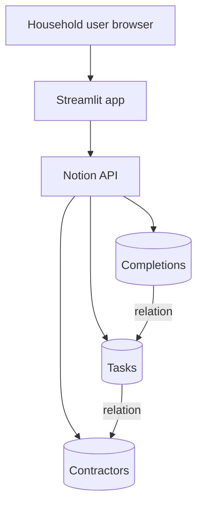
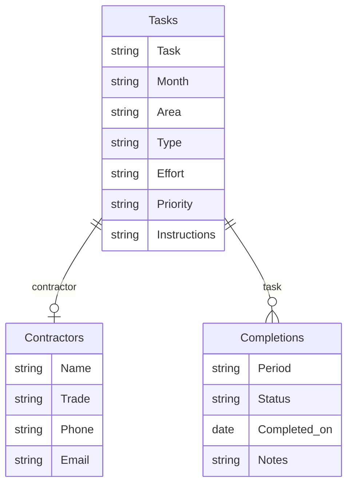
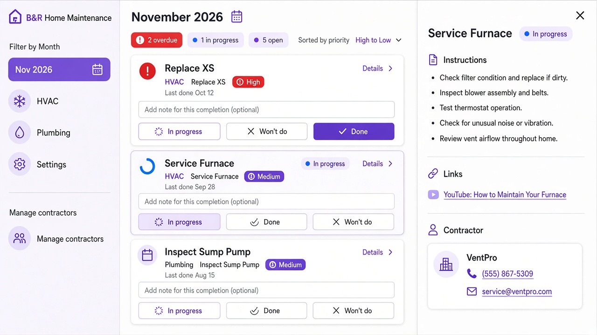

# Home Maintenance Hub — architecture

**Product:** **B & R Home Maintenance**  
**Repo:** `home-maintenance-hub` · **Package:** `home_maintenance_hub`

**Stack (locked):** **Python 3.12** · **Streamlit** (monthly board UX) · **Notion** (source of truth) · develop in **Cursor** with `just` / `uv` / `pytest`.

**v1:** Monthly checklist (mockup C): Done / Won’t do / **In progress**, details drawer, **Manage contractors**, urgency styling, priority sort. **No calendar view.** **No per-task due dates** — scheduling is **by month** only.

**v2:** Google Calendar sync + phone reminders (Notion remains catalog + completions).

**Superseded:** Hidden Google Sheet as production store (replaced by Notion 2026-11-19). Local JSON store remains for **offline dev/tests** only.

See [FEATURES.md](./FEATURES.md) for scope. **Approved UI mockup:** [§9](#9-ui--ux-alignment) · `docs/images/ui-mockup-c-v4-approved.jpg`.

---

## 1. System context



| Layer | Responsibility |
|-------|----------------|
| **Streamlit** | Monthly board, filters, actions, details drawer (view/edit), Manage contractors page, lavender theme |
| **Domain (`board`, `schedule`)** | Which tasks appear for month *M*, overdue/carry-over, urgency, priority sort, last-done |
| **Store (`notion` / `local`)** | CRUD templates, contractors, completions; pagination; map Notion properties ↔ dataclasses |
| **Notion** | Durable data, relations, rich instructions, optional “open in Notion” for power edits |

Streamlit does **not** run background jobs. Reminders are **v2 (GCal)** or optional **v1.1** digest (GitHub Action) — see §10.

---

## 2. Notion pivot — plan

### 2.1 Decision

| Before | After |
|--------|--------|
| Google Sheet: `templates`, `completions`, `contractors` tabs | **Three Notion databases** with the same logical roles |
| Sheet OAuth + `just init-sheet` | **Notion integration** + database IDs in env |
| Import from xlsx → Sheet | One-time **`just migrate-xlsx` → Notion** (idempotent) |

**Why pivot now:** Approved UI needs **relations** (contractors), **rich instructions/links**, editable metadata, and optional editing in the Notion app — poor fit for flat sheet columns.

**Single write path:** Streamlit (and migration scripts) write **Notion** only. The Ocala xlsx / Google Sheet become **import sources**, not live sync targets.

### 2.2 Phases

| Phase | Deliverable | Outcome |
|-------|-------------|---------|
| **P0 — Docs & schema** | This document + Notion DB templates (manual create or `init-notion` script) | Property names and select options frozen |
| **P1 — Store** | `store/notion.py`, config, mocked tests | Read/write three DBs via API 2025 data sources |
| **P2 — Migration** | `scripts/migrate_xlsx.py` | 61 `Home Maintenance` rows + empty contractors; dry-run |
| **P3 — Domain** | Extend models: `in_progress`, priority, type, effort, links, contractor | Board matches mockup rules |
| **P4 — UI** | Mockup C: drawer, contractors admin, in progress | Parity with approved mockups |
| **P5 — Cutover** | Point prod env at Notion; archive xlsx as backup | Sheet optional export only |

**Out of scope for pivot:** Rewriting REQUIREMENTS.md wholesale, GCal (v2), Streamlit Cloud deploy (can follow P4).

### 2.3 One-time manual setup (owner)

1. Create a Notion **teamspace page** (e.g. “B & R Home Maintenance”).
2. Create three databases (§3); note each **database ID** and **data source ID** (API).
3. Create an **internal integration**; share all three databases with it.
4. Set env vars (§9): `NOTION_API_KEY`, three data source IDs (or database IDs per grocery-hub pattern).
5. Run migration dry-run, then apply.
6. Smoke-test: `just ui` with `HOME_MAINTENANCE_HUB_STORE=notion`.

**Live workspace IDs:** see [NOTION_SETUP.md](./NOTION_SETUP.md) (hub page + three data source IDs created 2026-11-19).

Deprecated catalog (`Maintenance Tasks` 61 rows) may be **merged or replaced** by migration; do not maintain two live task catalogs.

---

## 3. Notion data model

Three databases. Naming convention: **`[MW] Tasks`**, **`[MW] Contractors`**, **`[MW] Completions`** (prefix avoids clashing with legacy DBs).

### 3.1 `[MW] Tasks` (templates)

One row per **scheduled appearance** (matches your xlsx: e.g. “Replace HVAC filter — January”). Notion holds **what** the task is; the app decides **how it behaves** on the monthly board.

| Property | Type | Required | Notes |
|----------|------|----------|--------|
| **Task** | title | yes | Display name |
| **Month** | select | yes | `January` … `December` (import from xlsx `Month`) |
| **Month #** | number | no | Sort helper (1–12); synced from xlsx |
| **Area** | select | yes | HVAC, Plumbing, Exterior, … |
| **Type** | select | yes | Replace, Service, Clean, Inspect/Test, … |
| **Effort** | select | yes | XS, S, M, … |
| **Priority** | select | yes | High, Medium, Low |
| **Season** | select | no | Winter, Spring, … (filter only; not on card) |
| **Active** | checkbox | yes | default true |
| **Instructions** | rich text | no | Standing steps; editable in drawer or Notion |
| **Links** | rich text or multi URL | no | Label + URL pairs; v1: rich text lines or JSON in a text property `Links JSON` if needed |
| **Contractor** | relation → Contractors | no | Single relation |
| **Cadence** | select | yes | `Annual` (default) or `Monthly` — monthly tasks appear every board month |
| **Stable key** | rich text | no | Annual: `task\|area\|month`; Monthly: `task_base\|area\|monthly` |
| **gcal_series_id** | rich text | no | **v2** only |

**Not stored on Tasks:** completion notes, last done date, in-progress state (live on **Completions**).

**Links encoding (v1 implementation):** Prefer a single **`Links`** text property storing JSON array `[{"label":"...","url":"..."}]` for reliable round-trip from Streamlit; optional later migration to Notion URL properties.

### 3.2 `[MW] Contractors`

| Property | Type | Required | Notes |
|----------|------|----------|--------|
| **Name** | title | yes | Company or contact |
| **Trade** | select | yes | Plumber, HVAC, Duct cleaning, … |
| **Phone** | phone or text | no | `tel:` in UI |
| **Email** | email | no | `mailto:` in UI |
| **Website** | url | no | |
| **Notes** | rich text | no | |
| **Active** | checkbox | yes | |
| **Tasks** | relation → Tasks | auto | Back-link; roll up “used by N tasks” |

### 3.3 `[MW] Completions` (sparse log)

One row per **task + period** while status is open or when terminalized. **Notes only here** (completion notes).

| Property | Type | Required | Notes |
|----------|------|----------|--------|
| **Name** | title | app on upsert | e.g. `Done · Replace HVAC filter · Jun 2026` |
| **Task** | relation → Tasks | yes | |
| **Period** | rich text | yes | `YYYY-MM` for the month the action applies to |
| **Status** | select | yes | `in_progress`, `done`, `wont_do` |
| **Completed on** | date | no | Set on terminal states; optional `started_on` for in_progress |
| **Notes** | rich text | no | **Completion** note only |
| **gcal_instance_id** | rich text | no | **v2** |

**Rules:**

- At most **one** completion row per `(Task, Period)` — updates are **in-place** (Notion page update), not append-only duplicates.
- **In progress** is non-terminal: task stays on board with badge until **Done** or **Won’t do**.
- **Last done** on card: latest `done` row for that Task (any period), by `Completed on`.



---

## 4. Product behavior (monthly board)

### 4.1 Navigation (no calendar)

- Sidebar: **month picker** (`YYYY` + month), **area** filters, **Manage contractors**, **Settings**.
- No “full calendar”, no contractor calendar, no week grid in v1.

### 4.2 Which tasks appear for month *M*

1. Query **Tasks** where `Active` and `Month` matches *M* (by name or `Month #`).
2. Load **Completions** for relevant periods (view month and prior months for carry-over).
3. Build **BoardTask** list in domain layer.

### 4.3 Urgency (visual)

| State | Condition |
|-------|-----------|
| **Done / Won’t do** | Terminal completion for **view month** period |
| **In progress** | Completion `in_progress` for view month period |
| **Overdue** | Task owed for an **earlier** period in the same year (or prior policy month) with no terminal completion |
| **Open** | Active task for the view month with no completion row |

There is **no “due soon” state** and no `due_soon_days` window. Tasks are scheduled by **month**, not by a day inside the month, so urgency does not change as the calendar month runs out.

Month boundaries use `HOME_MAINTENANCE_HUB_TIMEZONE` (default `America/New_York`).

### 4.4 Sort order

1. Urgency bucket: **overdue** → **in progress** → **open** → completed (if shown)
2. **Priority:** High → Medium → Low
3. **Area**, then **Task** title

### 4.5 Actions (main card)

| Action | Effect |
|--------|--------|
| **In progress** | Upsert completion: `in_progress` for `period = YYYY-MM` of view |
| **Done** | Terminal `done` + optional note from in-card field |
| **Won’t do** | Terminal `wont_do` |
| Note field | Saved **only** on Done/Won’t do (not on template) |

### 4.6 Details drawer

| Mode | Content |
|------|---------|
| **View** | Instructions, links (new tab), contractor block (from relation), **Open in Notion** link |
| **Edit** | Task name, area, type, effort, priority, instructions, links, contractor picker; **Manage contractors** link |

### 4.7 Manage contractors

- Table: trade, name, phone, email, website, **# linked tasks**, edit.
- **Edit contractor** modal: **Used by N tasks** (relation rollup + links to tasks).
- CRUD writes **Contractors** DB only (contact fields not copied onto each task).

### 4.8 Last done

- Display: latest **`done`** completion for task (any period): date + notes snippet.
- Not editable in drawer (history integrity).

---

## 5. Domain layer (repo)

Pure Python — **no Notion imports**.

```
src/home_maintenance_hub/
  models.py          # Template, Contractor, Completion, BoardTask, Urgency, …
  domain/
    schedule.py      # month matching, period keys, overdue
    board.py         # build_month_board, sort, last_done
  store/
    base.py          # Protocol: TaskStore
    local.py         # JSON fixture store (tests / offline)
    notion.py        # production Notion client
    factory.py
  integrations/notion/
    client.py        # shared client, data source resolution
    tasks.py
    contractors.py
    completions.py
  ui/
    app.py           # entry
    views/           # board, drawer, contractors (target split)
    theme.py
    static/app_theme.css
  scripts/
    migrate_xlsx.py
    seed_local_data.py
  config.py
```

**Cadence note:** Migration infers **Monthly** when the same canonical task+area appears in multiple xlsx months (e.g. HVAC filter slots → one `Monthly` template). Completions use **`YYYY-MM` period keys** per board month for monthly tasks. Annual tasks keep one row per assigned month.

---

## 6. Store abstraction

```python
# Conceptual protocol — see store/base.py
class MaintenanceStore(Protocol):
    def list_tasks_for_month(self, year: int, month: int) -> list[Template]: ...
    def list_completions(self, *, task_ids: list[str] | None = None) -> list[Completion]: ...
    def upsert_completion(self, completion: Completion) -> None: ...
    def update_task(self, task: Template) -> None: ...
    def list_contractors(self, *, active_only: bool = True) -> list[Contractor]: ...
    def upsert_contractor(self, contractor: Contractor) -> None: ...
```

| `HOME_MAINTENANCE_HUB_STORE` | Use |
|----------------------------|-----|
| `local` | `.local/.../data.json` — default CI and fast UI dev |
| `notion` | Production |

Google Sheets backend removed (v1 uses **local JSON** or **Notion** only).

**Notion client:** Follow **Notion API 2025 data source** pattern (same approach as grocery-hub): resolve data source ID, paginate queries, map select enums strictly, surface API errors in Streamlit (NFR1).

---

## 7. Migration

### 7.1 Sources

| Source | Use |
|--------|-----|
| **Ocala xlsx — `Home Maintenance`** | Primary: 61 tasks → `[MW] Tasks` |
| **Ocala xlsx — `House Projects` Vendor column** | Optional seed hints; not auto-imported to contractors without review |
| **Deprecated Notion catalog** | Optional merge if IDs stable; otherwise xlsx wins |
| **Google Sheet URL** | Retired after cutover |

### 7.2 Column mapping (Home Maintenance → Tasks)

| xlsx | Notion |
|------|--------|
| Task | Task (title) |
| Month | Month (select) |
| Month # (sort) | Month # |
| Area | Area |
| Type | Type |
| Priority | Priority |
| Effort | Effort |
| Notes | Instructions (standing text only) |
| Season | Season |
| Done? | **Ignore** — use Completions after go-live |
| Assignees | Skip until used |

### 7.3 Idempotency

- **Stable key** = normalized `task|area|month`.
- Migration: `--dry-run` prints create / update / skip; safe to re-run (NFR2).

### 7.4 Contractors

- Start empty or manual CSV; link relations in Notion or via drawer after cutover.

---

## 8. Configuration & secrets

| Variable | Meaning |
|----------|---------|
| `HOME_MAINTENANCE_HUB_STORE` | `local` \| `notion` |
| `NOTION_API_KEY` | Integration secret |
| `HOME_MAINTENANCE_HUB_NOTION_TASKS_DS_ID` | Tasks data source ID |
| `HOME_MAINTENANCE_HUB_NOTION_CONTRACTORS_DS_ID` | Contractors data source ID |
| `HOME_MAINTENANCE_HUB_NOTION_COMPLETIONS_DS_ID` | Completions data source ID |
| `HOME_MAINTENANCE_HUB_TIMEZONE` | Default `America/New_York` |

Never commit secrets or xlsx with credentials (`Account Info` tab). NFR5.

Optional Streamlit Cloud: `secrets.toml` mirroring grocery-hub.

---

## 9. UI / UX alignment

**Approved mockup (v4)** — canonical target for v1 UI implementation:



Approved layout: **mockup C v4** — wide layout, sidebar month + area filters, inline stats (`overdue · in progress · open`), cards with status icon, **note inside card**, **Details** → right drawer, **Manage contractors** in sidebar. Actions: **In progress**, **Done**, **Won’t do**.

**Theme:** Lavender palette (`#e6e0f2` background, `#3a2849` text, `#6341a5` accent) — see `ui/theme.py`.

**Deferred UI:** Explicit Defer button (month-end implicit carry only), calendar views, due date fields.

---

## 10. Reminders & v2 calendar

| Version | Mechanism |
|---------|-----------|
| **v1** | In-app urgency only |
| **v1.1 (optional)** | Weekly email digest via GitHub Action querying Notion |
| **v2** | One-way **Tasks → Google Calendar** series; completions patch instances; partner subscribes to calendar |

Notion is **not** the recurrence engine for phone reminders in v2; **GCal** is. Notion keeps task metadata + completion audit.

---

## 11. Testing & quality

| Concern | Approach |
|---------|----------|
| Board / overdue / priority sort | **Unit tests** with fixture JSON (`local` store) — no live Notion in CI |
| Notion mapping | Contract tests with recorded JSON fixtures |
| Store integration | Optional manual / labeled integration test with `NOTION_CI` DB copies |
| Lint | `ruff` + `pytest` via `just check` |

---

## 12. Deployment (target)

- **Local:** `just setup` → `just ui` (port **8765**).
- **Hosted (optional):** Streamlit Community Cloud + Google OAuth allowlist (same ops pattern as grocery-hub).
- **Notion:** Integration must have access to all three databases in prod and optional `[MW CI]` clones.

---

## 13. Rejected / out of scope (v1)

- Apps Script–first, Zapier/Make as core sync
- Dual live sync Sheet ↔ Notion
- Per-task due dates in UI (month-only scheduling)
- **Due soon** / `due_soon_days` (no day-level window inside a month)
- Calendar view (any variant)
- Defer as a first-class button
- Storing completion notes on task templates

---

## 14. Revision log

| Date | Change |
|------|--------|
| 2026-11-17 | Lock Streamlit + Sheet + GCal; Cursor-first |
| 2026-11-17 | Sparse completions; pending computed in app |
| 2026-11-19 | Mockup C: drawer, contractors, in progress, no due dates |
| 2026-11-19 | **Pivot to Notion** — full architecture; Sheet superseded |
| 2026-11-19 | Drop **due soon** / `due_soon_days`; urgency is month-only (overdue, in progress, open, terminal) |
| 2026-11-19 | Commit approved UI mockup to `docs/images/ui-mockup-c-v4-approved.jpg` |
