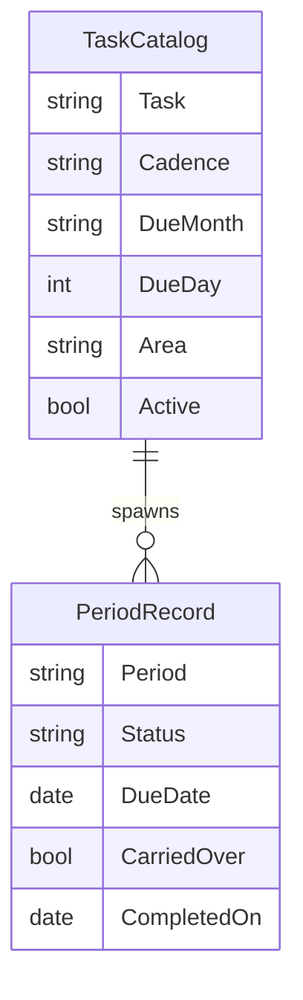
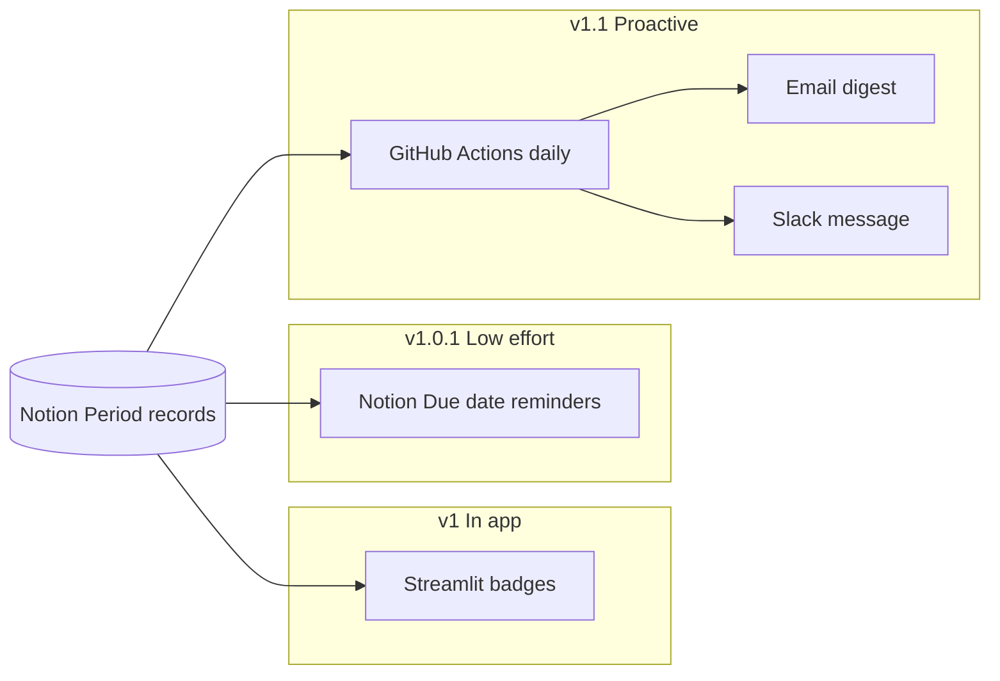

# Household recurring tasks — requirements & specification

**Status:** Draft for review  
**Product:** Streamlit app + Notion as source of truth (pattern: [grocery-wizard](https://github.com/rachelgramlich/grocery-wizard))  
**Working name:** Household Tasks (repo TBD)

---

## 1. Problem statement

Household maintenance and recurring chores are spread across a Google Sheet and a partly deprecated Notion setup. There is no single place to see **what is due this month**, what **carried over as overdue**, or to record **done / won’t do / defer** with history. The goal is a focused Streamlit UI on top of Notion, with optional proactive reminders.

---

## 2. Goals

| ID | Goal |
|----|------|
| G1 | **Single monthly view** of recurring tasks (monthly and annual cadences). |
| G2 | **Notion is source of truth** for task definitions and per-period outcomes (editable in Notion if needed). |
| G3 | **Clear urgency** in the UI: overdue (red), due soon (orange), normal, completed hidden by default. |
| G4 | **Carry-over:** unfinished tasks from prior periods surface as overdue until resolved (done, won’t do, or defer). |
| G5 | **Migrate** existing task list from Google Sheet (and optionally the 61-row deprecated Notion catalog). |
| G6 | **Household-friendly deploy** later (Streamlit Cloud + Google allowlist), matching grocery-wizard operations. |

---

## 3. Non-goals (v1)

- Multi-household / multi-tenant SaaS.
- Complex project management (subtasks, dependencies, time tracking).
- Replacing Notion for free-form notes (app complements Notion).
- Native mobile app (responsive web is enough).
- Automatic vendor scheduling or cost analytics (optional fields only).
- Full bidirectional sync with Google Sheet after migration (Notion wins).

---

## 4. Users & context

- **Primary user:** Household member managing home maintenance (you).
- **Secondary:** Partner (same allowlist if deployed to Cloud).
- **Usage pattern:** Short sessions (5–10 min) at month start or when a reminder fires; occasional mid-month checkoffs.
- **Existing data:**
  - Deprecated Notion DB: **Maintenance Tasks** (61 templates) + **Maintenance Completions** (log without period/status).
  - Google Sheet: canonical list to migrate (structure TBD).

---

## 5. User stories

### Monthly workflow

| ID | Story | Acceptance hint |
|----|-------|-------------------|
| US1 | As a user, I open the app and see **this month’s** tasks grouped by urgency. | Default month = calendar month in user timezone. |
| US2 | As a user, I mark a task **Done** and it leaves the active list with a completion date. | Notion updated; UI refreshes. |
| US3 | As a user, I mark **Won’t do** for this period only. | Does not carry over; archived for that period. |
| US4 | As a user, I **Defer to next month** so the task appears next period, not as overdue today. | Status = Deferred; next period gets pending row. |
| US5 | As a user, I see **overdue** items from missed prior months in red at the top. | Carried-over flag + copy explains origin period. |
| US6 | As a user, I filter or group by **Area** (HVAC, Exterior, …). | Matches catalog metadata. |
| US7 | As a user, I switch to **another month** to review history or catch up. | Read-only past months allowed; actions only where policy allows. |

### Administration

| ID | Story |
|----|-------|
| US8 | As a user, I add/edit task **templates** in Notion (or a simple in-app form later). |
| US9 | As a user, I run a **one-time migration** from Google Sheet into Notion catalog. |

### Reminders (optional v1 / v1.1)

| ID | Story |
|----|-------|
| US10 | As a user, I get notified when tasks are **due or overdue** without opening the app. |

---

## 6. Functional requirements

### 6.1 Task catalog (templates)

Each template row describes a **recurring definition**, not a single month’s work.

| Req ID | Requirement |
|--------|-------------|
| FR-C1 | **Task** title (required). |
| FR-C2 | **Cadence:** `Monthly` or `Annual`. |
| FR-C3 | **Annual:** **Due month** (required for annual); optional **Due day** (1–28 recommended default 1 if blank). |
| FR-C4 | **Monthly:** due every calendar month; optional **Due day** (default: last day of month or 1st — **decision needed**). |
| FR-C5 | Metadata: **Area**, **Type**, **Effort**, **Priority**, **Notes** (optional; align with existing Notion enums where possible). |
| FR-C6 | **Active** checkbox; inactive templates do not spawn new period rows. |
| FR-C7 | Optional **Assignees** (person) for display only in v1. |

### 6.2 Period records (instances)

One row per **(template, period)** when the task is in play for that period.

| Req ID | Requirement |
|--------|-------------|
| FR-P1 | **Period key:** `YYYY-MM` for monthly tasks; for annual, `YYYY` or `YYYY-MM` per due rule (**decision needed**). |
| FR-P2 | **Status:** `Pending`, `Done`, `Won't do`, `Deferred`. |
| FR-P3 | **Due date** (date): computed when row is created (for sorting and reminders). |
| FR-P4 | **Carried over** (checkbox): true when created because a prior period was unresolved. |
| FR-P5 | **Completed on** (date): set when status → Done. |
| FR-P6 | **Relation** to catalog template (required). |
| FR-P7 | Rows are **lazy-created** when viewing a month (no batch job required for core UX). |

### 6.3 Scheduling & urgency rules

| Req ID | Rule |
|--------|------|
| FR-S1 | **Overdue (red):** Period ended (or due date passed — **decision needed**) AND status still `Pending`, OR carried-over row from earlier period still `Pending`. |
| FR-S2 | **Due soon (orange):** `Pending` AND due date within **N days** (default **N = 7**, configurable). |
| FR-S3 | **Deferred:** Current period row → `Deferred`; create/activate **next** period row as `Pending` (not overdue until that period’s rules say so). |
| FR-S4 | **Won't do:** Terminal for that period; no carry-over. |
| FR-S5 | **Done:** Terminal for that period; optional append to **completion log** for history (merge with or replace legacy Completions DB — **decision needed**). |
| FR-S6 | At month boundary, unresolved **Pending** rows generate **carried over** pending rows in the new month (or mark original overdue — **decision needed** for single vs duplicate rows). |

### 6.4 UI (Streamlit)

| Req ID | Requirement |
|--------|-------------|
| FR-U1 | Sidebar: month picker, filters (Area, cadence), toggle “Show completed”. |
| FR-U2 | Main: sections **Overdue** → **Due this week** → **Later this month** (order fixed). |
| FR-U3 | Each task row: title, area, effort, due date, badges (overdue / due soon). |
| FR-U4 | Actions: Done, Won’t do, Defer (confirm on defer optional). |
| FR-U5 | Empty states: no tasks, all complete, Notion misconfigured. |
| FR-U6 | Link to Notion page for power users (optional). |

### 6.5 Configuration & secrets

| Req ID | Requirement |
|--------|-------------|
| FR-X1 | Env: `NOTION_API_KEY`, `NOTION_TASK_CATALOG_DATABASE_ID`, `NOTION_PERIOD_RECORDS_DATABASE_ID`. |
| FR-X2 | Optional: `HOUSEHOLD_TASKS_DUE_SOON_DAYS`, timezone default `America/New_York`. |
| FR-X3 | Local dev without auth; Cloud deploy with Google allowlist (parity with grocery-wizard). |

### 6.6 Migration

| Req ID | Requirement |
|--------|-------------|
| FR-M1 | Import from **CSV export** of Google Sheet (v1 path; no Google OAuth required). |
| FR-M2 | Column mapping documented in `docs/migration-mapping.md` after sheet review. |
| FR-M3 | `--dry-run` reports creates/updates/skips. |
| FR-M4 | Optional import from deprecated Notion catalog (61 rows). |

---

## 7. Data model (Notion)

Two databases (production); optional `[HT CI]` copies for testing.

**Legacy:** `Maintenance Completions` may remain as a read-only archive or be folded into Period records + status Done (**decision needed**).

---

## 8. Non-functional requirements

| ID | Requirement |
|----|-------------|
| NFR1 | Notion API errors shown clearly; no silent data loss. |
| NFR2 | Idempotent migration (re-run safe on title+area key). |
| NFR3 | Unit tests for scheduling/carry-over without live Notion. |
| NFR4 | Python 3.12, `uv`/`just`, ruff/pytest (lightweight vs grocery-wizard). |
| NFR5 | Personal data never committed to git. |

---

## 9. Reminders — product requirements

| Req ID | Requirement | Priority |
|--------|-------------|----------|
| REM1 | User can receive **at least one** proactive nudge per week or per due task. | Should (v1.1) |
| REM2 | Reminders must respect **Done / Won’t do / Deferred** (no spam). | Must |
| REM3 | Overdue tasks should **re-notify** on a bounded cadence (e.g. weekly, not hourly). | Should |
| REM4 | Content includes task name, due date, link to app or Notion. | Should |

---

## 10. Reminders — feasibility (technical)

Streamlit **does not run in the background**. When the browser tab is closed, the app cannot send notifications. Reminders require **an external scheduler** or **Notion’s notification system**.

### Option A: Notion-native reminders

**How it works:** Set `Due date` on period rows (or Notion reminders on that property). Users with Notion mobile/desktop get OS notifications when Notion fires reminders.

| | |
|--|--|
| **Feasibility** | High — no extra infra if you already use Notion on your phone. |
| **Pros** | Zero email API; works offline of Streamlit; partner can subscribe in Notion. |
| **Cons** | Easy to get noisy; per-row setup if not automated; reminder UX is Notion’s, not custom; must keep Due date accurate when deferring. |
| **Engineering** | App writes `Due date` on lazy row creation; optional script to bulk-set Notion reminder offset. |
| **Fit for v1** | **Best low-effort add-on** alongside in-app red/orange. |

### Option B: Scheduled job (GitHub Actions cron)

**How it works:** Daily workflow runs a Python script: query Notion → filter pending/overdue → send digest email (SendGrid, Resend, Amazon SES) or post to Slack webhook.

| | |
|--|--|
| **Feasibility** | High — same pattern as grocery-wizard’s Notion CI workflows; secrets in GitHub. |
| **Pros** | One **weekly digest** email (“3 overdue, 2 due this week”); full control of copy and cadence. |
| **Cons** | Requires email provider account + API key maintenance; GitHub Actions minute usage; not true “push at 9am on due day” unless you tune cron. |
| **Engineering** | ~1 workflow + `scripts/send_reminders.py` + dedupe state (e.g. “last_reminded_at” on row or KV in repo). |
| **Fit for v1** | **Best for email digests** if you want reminders outside Notion. |

### Option C: Slack

**How it works:** Cron or GitHub Action posts to a private channel or DM via Slack incoming webhook / bot token.

| | |
|--|--|
| **Feasibility** | High if you already use Slack daily; Medium if not. |
| **Pros** | Good for household shared channel; links clickable. |
| **Cons** | Another integration to secure and rotate. |
| **Fit** | Good **alternative to email** for your household. |

### Option D: Calendar export (iCal / Google Calendar)

**How it works:** Generate recurring calendar events or monthly `GET /feed.ics` from Notion.

| | |
|--|--|
| **Feasibility** | Medium — calendar apps remind well but **defer/carry-over** does not map cleanly to static RRULE events. |
| **Cons** | Dual maintenance unless events are generated only from period rows (heavier). |
| **Fit** | Better as **supplement** for annual HVAC-style tasks than for full checklist logic. |

### Option E: Third-party push (ntfy, Pushover, Twilio SMS)

| | |
|--|--|
| **Feasibility** | Medium — simple HTTP from cron; extra app on phone. |
| **Fit** | Nice if you want phone push without email; small scripts. |

### Recommended phasing

1. **v1:** In-app red/orange only (always works).
2. **v1.0.1:** Populate **Due date** on all period rows → enable **Notion reminders** (Option A) for high-priority tasks or all tasks.
3. **v1.1:** **Weekly digest** via GitHub Actions + email or Slack (Option B/C), with REM2/REM3 dedupe logic.

---

## 11. Open decisions (need your input)

Answer these to freeze the spec for implementation.

### Product

1. **Default monthly due day:** 1st of month, last day, or per-task from sheet?
2. **Overdue definition:** Due date passed, or “previous calendar month ended with no terminal status”?
3. **Carry-over model:** One row per period (new month = new row + carried flag) vs single row that moves period key?
4. **Annual tasks:** Show only in due month, or visible all year with orange in due month?
5. **Completion history:** Keep separate Completions log or only Period records?

### Data / migration

6. **Google Sheet:** Share column headers or CSV sample (or URL with export instructions).
7. **Source of truth after migration:** Sheet retired or kept as backup only?
8. **Reuse deprecated Notion catalog** as-is vs clean rename to `[HT] Task catalog`?

### Reminders

9. **Primary channel:** Notion mobile, email digest, Slack, or combination?
10. **Cadence:** Day-of due, 3 days before, weekly Sunday digest, or all of the above by priority?
11. **Partner notifications:** Same channel for both household members?

### Deploy

12. **Repo name** and **Streamlit deploy** in v1 or local-only first?
13. **Timezone** for month boundaries: `America/New_York`?

---

## 12. Success metrics (informal)

- You open the app (or read digest) **at least monthly** and clear overdue within the month.
- Migration completes with **zero duplicate** templates and spot-check of 10 tasks.
- No reminder fires for tasks marked Done/Won’t do in the same period (REM2).

---

## 13. Revision log

| Date | Change |
|------|--------|
| 2026-11-17 | Initial draft from planning session + deprecated Notion schema review |