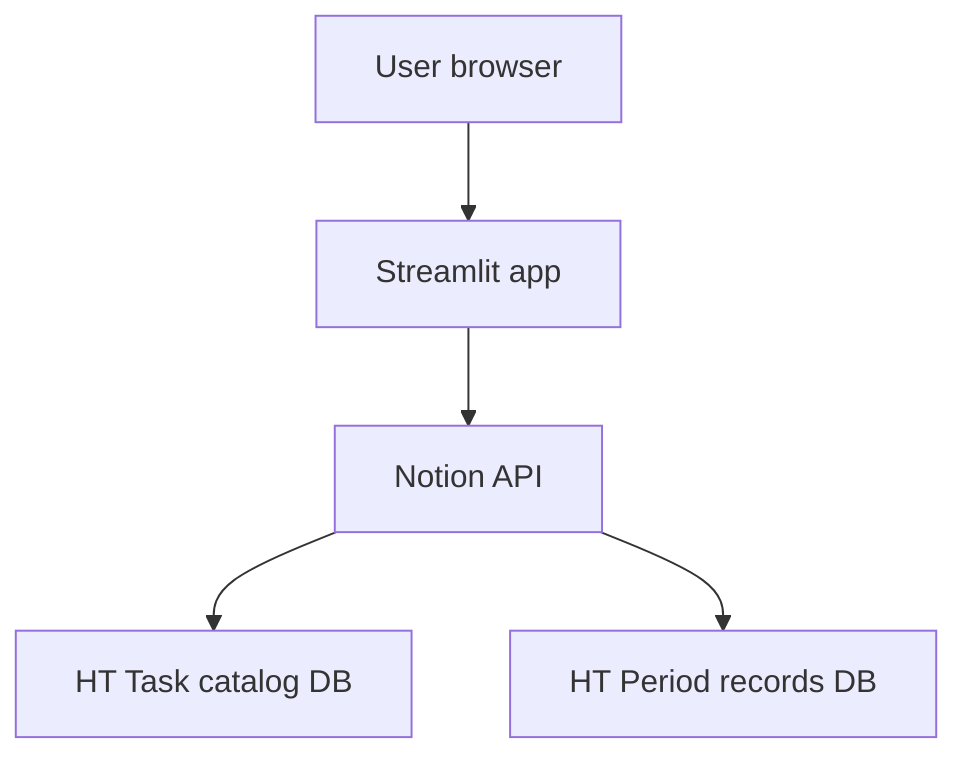
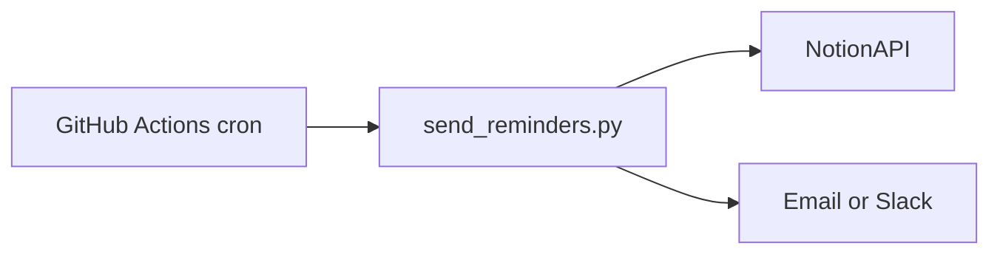

# Household recurring tasks — technical specification (draft)

> **Canonical architecture:** [ARCHITECTURE.md](./ARCHITECTURE.md) (Notion pivot, three databases, mockup C UI). This file is legacy detail; reconcile when implementation starts.

Companion to [REQUIREMENTS.md](./REQUIREMENTS.md).

---

## 1. System context



Optional (v1.1):



---

## 2. Repository layout (target)

```
src/household_tasks/
  config/__init__.py          # pydantic-settings: Notion IDs, tz
  integrations/notion/
    client.py                 # shared Notion client + data source resolution
    catalog.py                # template CRUD + query active
    periods.py                # period row CRUD + query by month
  domain/
    schedule.py               # period_key, due_date_for(template, period)
    urgency.py                # overdue | normal
    carryover.py              # ensure rows for month; carry unresolved forward
    actions.py                # done, wont_do, defer transitions
  ui/
    app.py
    theme.py                  # CSS for status chips
    views/month_board.py
scripts/
  migrate_gsheet_csv.py
  migrate_deprecated_notion.py
  send_reminders.py           # v1.1
tests/src/household_tasks/domain/
```

---

## 3. Domain algorithms

### 3.1 Period key

- **Monthly template:** `period_key = f"{year:04d}-{month:02d}"` for the month being viewed.
- **Annual template:** default `period_key = f"{year:04d}"` when viewing month `M`:
  - If `M == due_month`: task appears in that month’s board.
  - If spec chooses “annual visible only in due month,” other months omit the template.

### 3.2 Due date computation

| Cadence | Due date in period `YYYY-MM` |
|---------|------------------------------|
| Monthly | `YYYY-MM-{due_day}` clamped to last day of month |
| Annual | `YYYY-{due_month}-{due_day}` |

All comparisons use timezone `TZ` (default `America/New_York`).

### 3.3 Urgency

```python
# Pseudocode
if status in (Done, WontDo):
    display = hidden  # unless show_completed
elif status == Pending and (carried_over or period_key < current_period):
    display = overdue      # red — earlier month still open
else:
    display = normal       # open for the whole view month; no due-soon window
```

### 3.4 Month open workflow (`ensure_month_periods`)

For selected `(year, month)`:

1. Load all **Active** catalog templates applicable to that month (cadence rules).
2. For each template, compute `period_key` and `due_date`.
3. Query existing period rows for that key + template relation.
4. If missing, **create** row: `Pending`, `Due date`, `Carried over=false`.
5. **Carry-over pass:** For each template, if prior period has `Pending` and period ended per policy, create current row with `Carried over=true` OR upgrade display urgency on existing row (per product decision).

### 3.5 Actions

| Action | Period row updates | Side effects |
|--------|-------------------|--------------|
| Done | Status=Done, Completed on=today | — |
| Won't do | Status=Won't do | — |
| Defer | Status=Deferred | Create next period row Pending (defer does not mark Done) |

---

## 4. Notion API

- Use Notion API 2025 **data source** pattern (as grocery-wizard `NotionRecipesDB`).
- Property read/write for: title, select, status, date, checkbox, relation.
- Pagination on all queries.
- Cache in Streamlit `@st.cache_data(ttl=60)` for catalog; invalidate on write.

---

## 5. Streamlit UI spec

| Element | Behavior |
|---------|----------|
| `st.session_state.selected_month` | `(year, month)` tuple |
| Summary metrics | Count overdue and open this month |
| Task card | Columns: badge, title, meta, actions |
| CSS | `.ht-overdue { border-left: 4px solid #dc3545; }` etc. |

Page config: `layout="wide"`, page title **Household Tasks**.

---

## 6. Migration spec

### CSV expected columns (to be confirmed)

Minimum: `Task`, `Cadence`, `Month` or `Due month`, optional `Area`, `Type`, `Priority`, `Effort`, `Notes`, `Due day`.

Normalization keys: `normalize(title) + "|" + normalize(area)`.

### Deprecated Notion import

- Source: collection `d7cb0608-b694-4103-b3ce-65af4fc82d3c` (61 rows).
- Map `Month` → annual due month; infer cadence: if task appears in one month only → Annual, else Monthly (**validate with sheet**).

---

## 7. Reminders implementation spec (v1.1)

### Notion path

- On period row create/update: set `Due date` property.
- Document for user: enable Notion notifications on mobile; optional default reminder “1 day before” at DB template level if Notion supports it on data source.

### Digest path

**Schedule:** `cron: '0 14 * * 0'` UTC → 9am EST Sunday (adjustable).

**Algorithm:**

1. Query all `Pending` period rows with `Due date` in `[-7d, +14d]` or `carried_over=true`.
2. Exclude rows whose status changed since last run (store `reminder_sent_at` optional property).
3. Send one message listing overdue + due this week.
4. Update `reminder_sent_at` to prevent duplicate within 6 days.

**Secrets:** `NOTION_API_KEY`, `REMINDER_SMTP_*` or `SLACK_WEBHOOK_URL`.

---

## 8. Testing

| Area | Tests |
|------|-------|
| `schedule.py` | due day clamping, Feb/leap, annual month filter |
| `urgency.py` | fixtures with frozen `today` |
| `carryover.py` | pending Jan → Feb creates carried row |
| `actions.py` | defer creates next period |

No live Notion in default CI (mock client).

---

## 9. Dependencies

```
streamlit[auth]>=1.42
notion-client>=2.2
pydantic-settings>=2.7
python-dotenv>=1.0
pandas>=2.0   # migration only
```

Python `>=3.12,<3.13` to match grocery-wizard.

---

## 10. Spec revision log

| Date | Change |
|------|--------|
| 2026-11-17 | Initial technical draft |