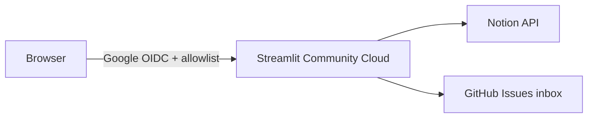

# Household deploy (Streamlit Community Cloud)

Ship **B & R Home Maintenance** as a private Streamlit Community Cloud app with **Google allowlist**, **Notion secrets server-side**, and **GitHub feedback inbox** (`user-feedback-inbox`). Matches the grocery-wizard household pattern (issue #4).

## Architecture

## One-time setup

### 1. Google OAuth

Reuse the **same Google Cloud OAuth Web client** as grocery-wizard. Add redirect URIs:

| App | Redirect URI |
| --- | --- |
| Maintenance (prod) | `https://<mw-subdomain>.streamlit.app/oauth2callback` |
| Maintenance (local) | `http://localhost:8765/oauth2callback` |

Each app needs its own `[auth].redirect_uri` and a **new** `cookie_secret` in Cloud Secrets.

### 2. Streamlit Community Cloud app

1. Connect `rachelgramlich/maintenance-wizard`, branch `main`.
2. **Main file path:** `src/maintenance_wizard/ui/app.py`.
3. Private app; paste **Secrets** TOML (shape: root `secrets.toml.example`).

| Secret | Purpose |
| --- | --- |
| `NOTION_*`, `MAINTENANCE_WIZARD_*` | Notion store (see `docs/NOTION_SETUP.md`) |
| `MAINTENANCE_WIZARD_STORE` | `notion` |
| `[auth]` | Google OIDC (`client_id`, `client_secret`, `redirect_uri`, `cookie_secret`, `server_metadata_url`) |
| `MAINTENANCE_WIZARD_REQUIRE_AUTH` | `true` |
| `MAINTENANCE_WIZARD_AUTH_EMAIL_ALLOWLIST` | Comma-separated household emails |
| `GITHUB_FEEDBACK_REPOSITORY` | `rachelgramlich/maintenance-wizard` |
| `GITHUB_FEEDBACK_TOKEN` | Fine-grained PAT, **issues:write** on this repo only |

**Local:** copy `secrets.toml.example` → `secrets.toml`, run `just link-secrets`. Default `MAINTENANCE_WIZARD_REQUIRE_AUTH = false`.

**Deps:** `streamlit[auth]` in `pyproject.toml` — run `just setup` / `uv sync` after pull.

### 3. GitHub feedback PAT

Create a **fine-grained** PAT: repository `maintenance-wizard`, permission **Issues → Read and write**. Paste as `GITHUB_FEEDBACK_TOKEN` in Cloud Secrets → **Reboot app**.

Verify: submit **Send feedback** → `gh issue list --label user-feedback-inbox --repo rachelgramlich/maintenance-wizard`.

## Manual smoke (after deploy)

1. Open HTTPS URL from a non-dev device.
2. Non-allowlisted Google account rejected; household emails allowed.
3. Monthly board loads from Notion; one reversible completion change, then revert in Notion.
4. **Send feedback** creates inbox issue.
5. DevTools: no `NOTION_*` / `GITHUB_*` in responses.
6. Confirm Google Console redirect URIs for prod and `localhost:8765`.

## Local vs Cloud

| Setting | Local `just ui` | Cloud |
| --- | --- | --- |
| `MAINTENANCE_WIZARD_REQUIRE_AUTH` | `false` | `true` |
| Store | `local` or `notion` | `notion` |
| Feedback | GitHub when token set | GitHub |

## Troubleshooting

| Symptom | Fix |
| --- | --- |
| OAuth redirect mismatch | Match `[auth].redirect_uri` to Google Console and Cloud URL |
| `StreamlitMissingAuthlibError` | `uv sync` / `just setup` for `streamlit[auth]` |
| Feedback failures | Check `GITHUB_FEEDBACK_TOKEN` in Secrets; reboot app |
| “Not authorized” after login | Add email to `MAINTENANCE_WIZARD_AUTH_EMAIL_ALLOWLIST` |

See also [docs/DEPLOYMENT.md](../DEPLOYMENT.md).